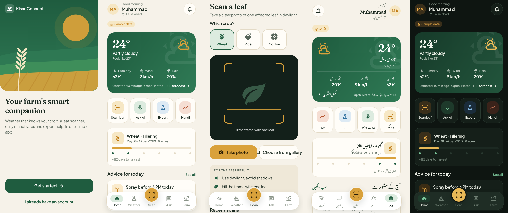

# KisanConnect

Smart farming assistant for farmers in Punjab, Pakistan. Built with Expo (React Native) and TypeScript.

> Status: **UI phase.** All screens are built and use clearly labelled sample data. Backend (Supabase), sign-in and AI arrive in the next phases. See [`docs/MASTER_PLAN.md`](docs/MASTER_PLAN.md).



## Features (planned, UI ready)
- **Today**: weather for your farm, crop stage, tasks and advice.
- **Weather intelligence**: hourly + 7-day forecast, spray window, irrigation advice (FAO-56), alerts.
- **Leaf scan**: on-device disease model with a cloud second opinion. Always "possible", never "confirmed".
- **Ask AI**: chat with text or voice that knows your crop, stage and weather.
- **Mandi rates** with a visible rate date, **expert questions**, **farm management**.
- **English + Urdu**, switch with one tap in Settings (RTL supported). Light, dark and auto themes.

## Tech stack
Expo SDK 58 · React Native 0.88 · TypeScript (strict) · Expo Router · Zustand · i18next · Reanimated · react-native-svg.
Planned: Supabase (Auth, Postgres, Storage, Edge Functions), Open-Meteo, on-device TFLite + Gemini (free tier).

## Run
```bash
npm install
cp .env.example .env      # add Supabase URL + anon key; without them the app runs in demo mode
npx expo start            # open in Expo Go (iOS simulator: press i)
npm run typecheck
```
Google sign-in uses Supabase's browser flow (`expo-web-browser`), so login works in Expo Go with no native build. Backend setup (SQL, providers, Edge Function) is in [`supabase/README.md`](supabase/README.md). Native builds for later phases (camera, voice) will use EAS cloud builds.

## Roadmap
| Phase | Scope | Status |
|---|---|---|
| 0 | Foundation, design system, full UI | ✅ Done |
| 1 | Auth (Google + email via Supabase), profile | ✅ Code done, needs Supabase keys |
| 2 | Farm & crop management, offline sync | ✅ Code done, test with docs/TESTING-PHASE2.md |
| 3 | Weather intelligence + push alerts | ✅ Code done, test with docs/TESTING-PHASE3.md |
| 4 | Crop disease detection (on-device + AI second opinion) | Planned |
| 5 | AI assistant + voice | Planned |
| 6 | Irrigation & reminders | Planned |
| 7 | Mandi prices | Planned |
| 8 | Expert connection | Planned |
| 9 | Hardening & release | Planned |

## Weather intelligence

- **Forecast:** Open-Meteo (14 days ahead, 30 days back), with MET Norway as a fallback, through the `weather-proxy` Edge Function. Farms are snapped to a ~11 km grid cell; one cached forecast per cell, provider and schema version is shared for 15 minutes ("now" uses Open-Meteo's 15-minute current conditions), and only the cell centre is sent to the provider. Each user can trigger a limited number of fresh fetches per hour. The phone keeps the last forecast per user and farm so it still shows offline, and refreshes it when the Weather or Home screen opens or the app comes back to the front if it is older than 15 minutes; after 24 h it says "Old forecast" and hides advice. Days 8–14 are shown as "Outlook (less certain)". Screens credit "Weather data by Open-Meteo.com" / "MET Norway" (CC BY 4.0).
- **Rules** (`src/engine`, plain TypeScript, unit-tested, copied into the Edge Functions):
  - Spray (05:00–19:00): avoid if rain chance > 40% within 6 h, wind > 15 km/h, gusts > 25 km/h or > 35 °C; take care if wind < 3 km/h, humidity < 40% or the rain chance is unknown.
  - Irrigation (FAO-56): Kc by growth period, root depth by stage, soil water from the farm's soil type, RAW = p × TAW × Zr, effective rain = 80% of days ≥ 5 mm, counted from the last logged irrigation. If nothing is logged on an older crop the app asks for it instead of guessing. Rice: keep standing water.
  - Alerts: heatwave (≥ 45 °C on 2+ days), crop heat stress at sensitive stages, frost for sugarcane/maize/heading wheat, heavy rain (≥ 35 mm/day), gusts ≥ 50 km/h, fog (visibility, or humid calm nights when visibility is missing).
  - Disease weather (by stage and season): wheat yellow rust, rice blast, cotton boll rot; cards link to Scan. No weather rule for cotton leaf curl (it's spread by whitefly).
  - Missing provider values are treated as "limited data", never as 0. All thresholds are indicative guides.
- **Alerts:** `weather-alerts` runs every 3 hours (pg_cron + Vault secret), stores each alert once in `alerts` (inbox, bell on Home), pushes it via Expo respecting the user's alert types and quiet hours, checks receipts and drops dead tokens. Phones without push (simulator, Expo Go on Android) get a local notification when the alert syncs in.

## Offline sync

Farm data (farms, crops, activity log) works fully offline and syncs with Supabase when there is internet.

- **Per-user database.** Each signed-in user gets their own SQLite file on the phone (`kisan-<userId>.db`). Signing out or deleting the account deletes that file; if the session simply expires, the file is kept and the app asks the user to sign in again to upload what's waiting. Demo mode and web use in-memory sample data.
- **Outbox.** Every save writes the row and an outbox entry in one transaction, so nothing is lost if the app closes. Edits to the same row before it's uploaded are merged into one entry; a row created and deleted before upload never reaches the server.
- **Compare-and-set versions.** Every server row has a `version` that the database bumps on each write. The app updates with `where version = <the version I started from>`. If someone else changed the row first, 0 rows change, the server copy wins locally and the row is marked "Updated from another device". A `last_op_id` on each row lets the app recognise its own write when a response was lost.
- **Delete wins.** Rows are soft-deleted (`deleted_at`). A deleted row can't be brought back, and deleting a farm or crop deletes its children on the server too.
- **Pull.** Changes are downloaded per table by `(updated_at, id)` pages with a 2-minute overlap; a cursor older than 90 days triggers a full re-download.
- Code: `src/db` (local storage, outbox), `src/sync` (engine, Supabase transport, triggers), `supabase/migrations/20261121000000_farms_crops_activities.sql` (tables, triggers, RLS), `supabase/tests/rls_farms.sql` (RLS checks).

## Project structure
```
src/
  app/                 Routes only (Expo Router)
    (onboarding)/      welcome, language, farm-setup
    (auth)/            sign-in, sign-up, forgot-password, check-email
    auth/              callback, reset (deep-link targets for email links + Google)
    (tabs)/            index (Home), weather, scan, assistant, farm
    scan/result, mandi, expert/, settings
  components/
    ui/                Reusable primitives (Text, Button, Card, Chip, TextField, ...)
    layout/            TabBar
  features/<feature>/components   Feature-specific components
  theme/               Palette, spacing/radius tokens, typography, ThemeProvider
  i18n/                i18next setup, languages, locales/en.json + ur.json
  hooks/               useDirection (RTL), useLocalized
  store/               Zustand settings store (persisted)
  config/env.ts        Public env (EXPO_PUBLIC_*) only
  mocks/               Sample data for UI work (to be replaced)
  types/               Domain types
```

## Design system
- **Palette "field almanac"**: paper cream `#F6F2E9`, forest green `#1F5C3F`, wheat gold `#D9A13B`, terracotta `#B5532E` for risk, sky `#2F6F9F` for weather. Full dark palette included.
- **Type**: Fraunces (display), Plus Jakarta Sans (UI), Noto Nastaliq Urdu (Urdu, with taller line height).
- 48 dp minimum touch targets, high contrast, icons with every label, read-aloud planned on every answer.

## Adding a language
1. Add it to `src/i18n/languages.ts` (code, native name, `ltr`/`rtl`).
2. Add `src/i18n/locales/<code>.json` with the same keys as `en.json`.
3. Add the language to data `Localized` fields where needed.

## Secrets
Only `EXPO_PUBLIC_*` values go in `.env` (they are bundled into the app). Server secrets such as the Gemini API key and Supabase service-role key live only in Supabase Edge Function secrets. `.env` is git-ignored.

## License
MIT © 2026 Sajjad Khalid
