# KisanConnect

**A smart farming assistant for smallholder farmers in Punjab, Pakistan: offline-first farm records, crop-aware weather alerts and an AI leaf check with safety guardrails, in English and Urdu.**

<p align="center">
  
  &nbsp;&nbsp;
  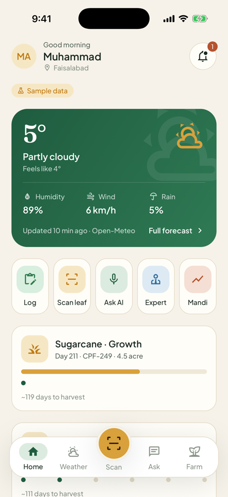
  &nbsp;&nbsp;
  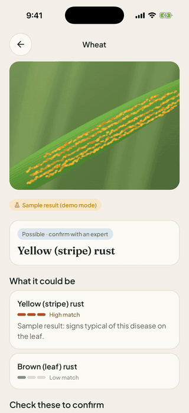
</p>

## The problem

Most farmers in Punjab decide when to irrigate, spray or ask for help from experience and word of mouth. Weather apps are generic, connectivity in the field is patchy, and a wrong spray (wrong product, wrong dose, rain an hour later) costs money and harms the crop. Plant-disease apps that "diagnose" from a photo often sound certain when they are not, and some recommend chemicals and doses directly.

## The solution

KisanConnect keeps a farmer's farms, crops and field activities on the phone and syncs them when there is signal. It turns a forecast into advice for the crop the farmer is actually growing (spray windows, irrigation timing, heat, frost and disease-weather warnings) and pushes alerts for their farms. A leaf photo gets a careful second opinion, "possible" rather than "confirmed", and treatment advice only ever comes from a vetted knowledge base, never from the AI.

## Features

- **Offline-first farm and crop tracking.** Farms, crops (including planned sowings), irrigation, fertiliser, spray and harvest logs work without a connection. Changes queue locally and sync in the background with conflict handling.
- **Crop growth-stage engine.** Wheat, rice, cotton, sugarcane and maize calendars place each crop on its stage timeline from the sowing date, with days to the next stage and to harvest.
- **Hyperlocal weather with farm alerts.** Current conditions, a 24-hour strip, a 7-day forecast and a less-certain outlook to 14 days. Spray windows, FAO-56 crop water use and irrigation advice, and heat, frost, heavy-rain, wind and fog alerts per farm, delivered as push notifications by a scheduled server job.
- **AI leaf check with guardrails.** A photo quality check catches blurry, dark and too-far images first. A cloud vision model then proposes likely causes, restricted to a per-crop allow-list of diseases, with questions to confirm and safe next steps. A dose filter removes any amount, rate, product or chemical from AI text. Results are "likely", "possible" or "unclear", and the expert button is always one tap away.
- **Bilingual and RTL-ready.** English and Urdu (Nastaliq) switch instantly, with full right-to-left layout. Light, dark and automatic themes, 48 dp touch targets and icons on every label.
- **Privacy built in.** Explicit consent before any photo leaves the phone, private per-user photo storage, automatic clean-up, data export and account deletion.

## Screenshots

| | | |
|:-:|:-:|:-:|
| 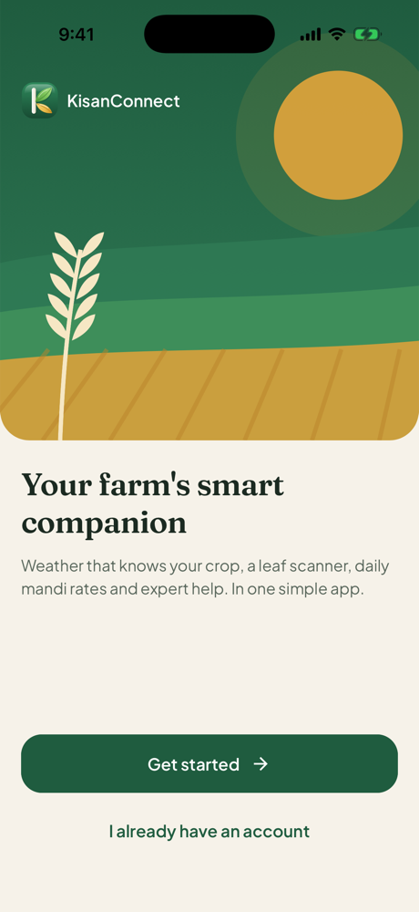 | 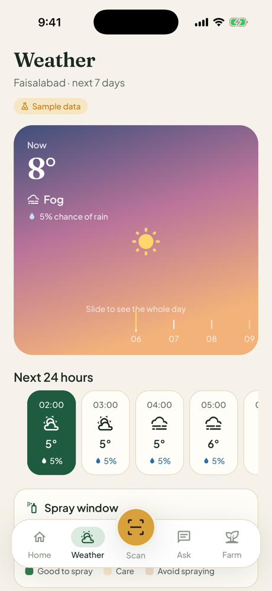 | 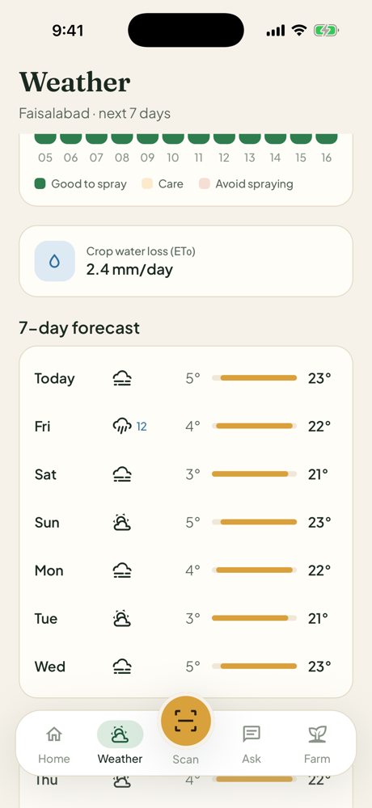 |
| Welcome | Weather for the farm | 7-day forecast |
| 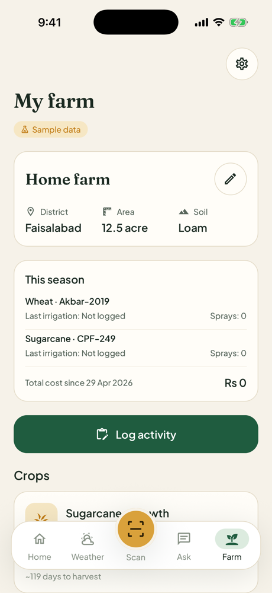 | 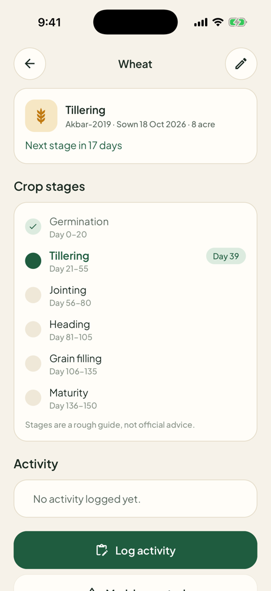 | 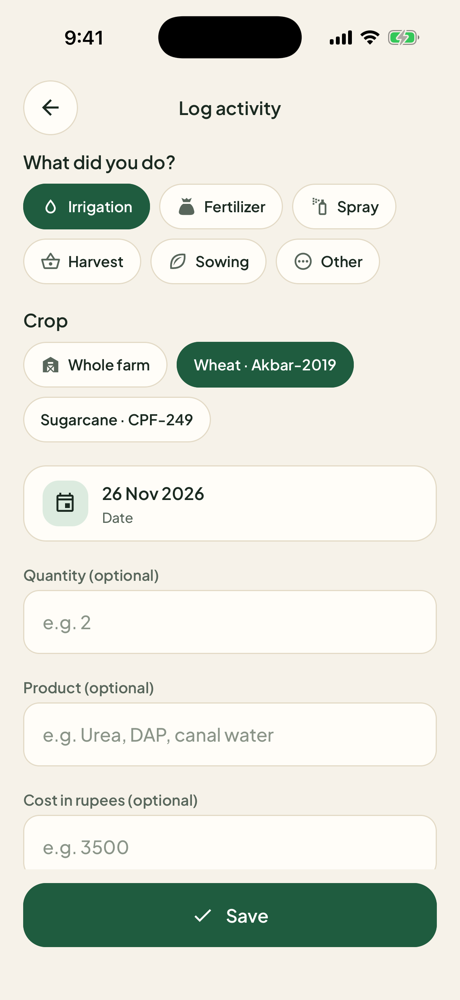 |
| Farm summary | Crop stage timeline | Activity log |
| 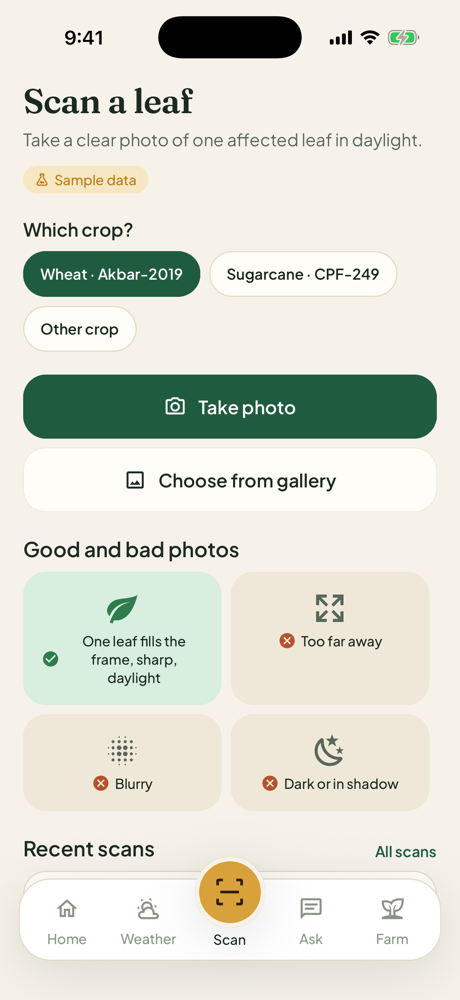 | 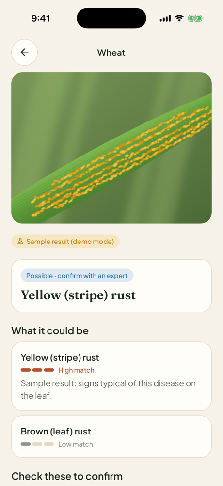 | 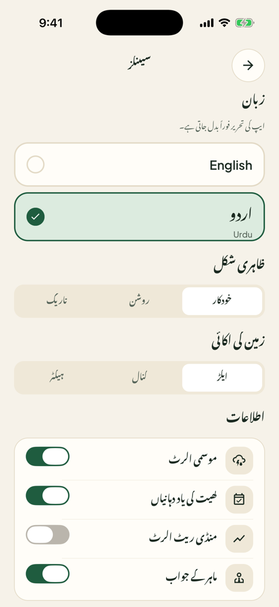 |
| Scan with photo guide | Leaf check result | Urdu, right to left |

<p align="center">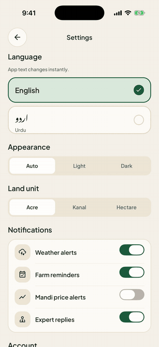</p>

<sub>Screens show the built-in demo mode with sample data. The leaf image is an illustration.</sub>

## Tech stack

| Layer | Technology |
|---|---|
| App | Expo SDK 58, React Native 0.88, TypeScript (strict), Expo Router (typed routes), Zustand, i18next, Reanimated |
| On-device data | Expo SQLite (one database per user, versioned migrations) |
| Backend | Supabase: Postgres with Row Level Security, Auth (email and Google), Storage, Edge Functions (Deno), pg_cron, Vault |
| Weather | Open-Meteo with MET Norway fallback, cached server-side per grid cell |
| AI | Groq vision model (OpenAI-compatible API, JSON mode) behind an Edge Function; on-device TFLite model (MobileNetV3) training notebook in `ml/` |
| Notifications | Expo push notifications |
| Testing | Jest (unit), SQL tests for Row Level Security, `deno check` for Edge Functions |

## Architecture and engineering decisions

- **Offline outbox with compare-and-swap sync.** Every local write goes into an outbox in the same SQLite transaction as the row change. Pending operations on the same row are coalesced (create + delete never reaches the server). Pushes carry the row's base version, and the server applies them only if the version still matches, so concurrent edits from two devices are detected rather than silently overwritten. Pulls page through `(updated_at, id)` cursors.
- **Per-user local database.** Each signed-in user gets their own SQLite file, so data never mixes on a shared phone. Schema changes run as ordered migrations tracked with `PRAGMA user_version`, tested against databases from every earlier version.
- **Security enforced on the server.** Row Level Security on every table, composite foreign keys that tie a crop or scan to the same user's farm, triggers that keep server-only columns (AI results, roles) out of client reach, and a private storage bucket where each user can only touch their own folder. Every Edge Function verifies the caller itself, and scheduled jobs authenticate with a secret stored in Vault.
- **One rules engine for app and server.** Crop calendars, weather rules, irrigation maths, the disease knowledge base, the dose filter and the scan-combining logic are pure TypeScript in `src/engine`. A script copies the engine into the Edge Functions, and a unit test fails if the copy is stale, so phone and server never disagree.
- **AI cost and quota guardrails.** Each check atomically takes one unit from a per-user daily cap and a shared daily budget, or neither. Units are refunded when the model is busy or misconfigured, busy responses are retried with backoff, and setup errors leave a scan "waiting" instead of failing it. Only short error codes are logged: never prompts, photos or keys.
- **Safety by design for AI advice.** The model may only answer with disease ids from the crop's allow-list. Its text is filtered for doses, rates, products, chemicals and non-Latin script, and treatment advice is shown only from the knowledge base. The phone-reported on-device result is treated as untrusted input.
- **Privacy.** Consent is versioned, so a change in AI provider asks again. Prompts carry crop, stage, district and a weather summary, never names, contact details or GPS. Photos live in private storage, deleted scans and orphan files are cleaned up daily, and account deletion removes everything.

## Testing

184 unit tests (Jest) cover the rules engine, sync and outbox logic, SQLite migrations on a real SQLite engine, the scan queue and the AI response handling. SQL test scripts verify Row Level Security and privileges for farms, weather and scans, and every Edge Function passes `deno check`.

```bash
npx tsc --noEmit
npm test
```

## Run locally

```bash
npm install
cp .env.example .env   # optional: add your Supabase URL and anon key
npx expo start
```

Without Supabase keys the app runs in demo mode with clearly labelled sample data. Backend setup (migrations, Edge Functions, schedules) is described in [`supabase/README.md`](supabase/README.md). Only `EXPO_PUBLIC_*` values belong in `.env`; server secrets live in Supabase Edge Function secrets.

## Credits

Weather data by [Open-Meteo](https://open-meteo.com) and [MET Norway](https://api.met.no) (CC BY 4.0). Leaf-model training datasets are listed with their licences in [`ml/DATASETS.md`](ml/DATASETS.md).

## Author

**Sajjad Khalid** · [GitHub](https://github.com/sajjadHunjra71)

MIT License
